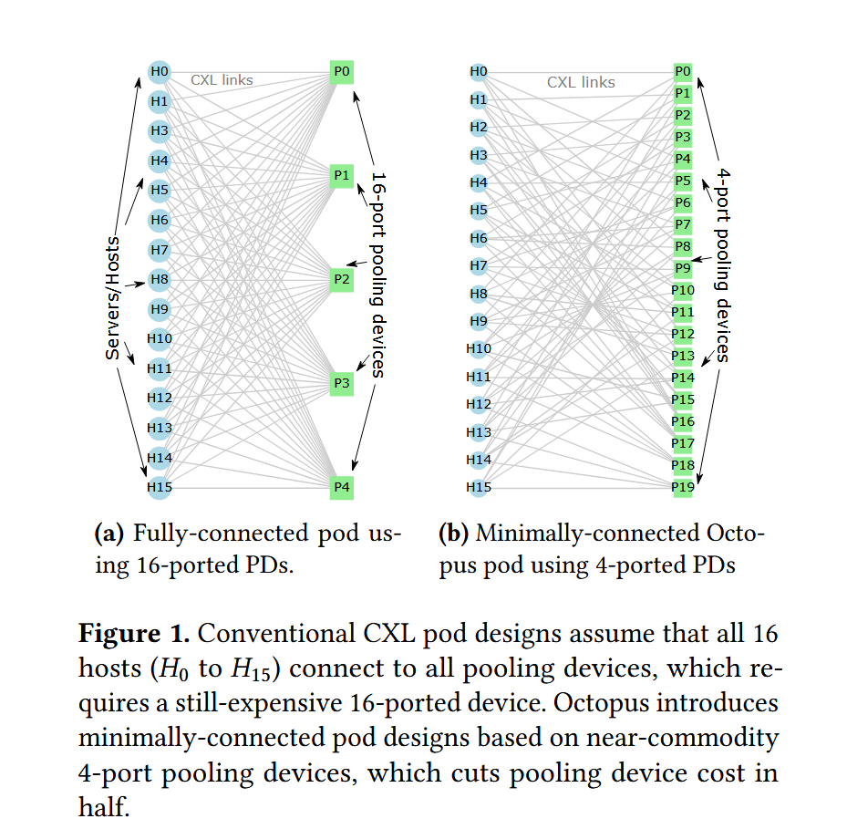

**Octopus：Scalable Low-Cost CXL Memory Pooling**
>Daniel S. Berger (Microsoft Azure, University of Washington), Yuhong Zhong (Columbia University, Microsoft Azure), Fiodar Kazhamiaka (Microsoft Azure), Pantea Zardoshti (Microsoft Azure), Shuwei Teng (Microsoft Azure), Mark D. Hill (University of Wisconsin-Madison), Rodrigo Fonseca (Microsoft Azure)

## 背景

传统的 CXL pod 设计都建立在主机与所有 CXL 池化设备必须全连接的假设上，现有的 pod 规模都较小而且使用了昂贵的多端口池化设备或者交换机，大规模的池化设备更为昂贵。在此基础上，作者团队提出了一种全新的 pod 拓扑设计。

## 主要贡献

作者提出了 Octopus ，一种全新的 CXL pod 拓扑结构，可以使用小规模的端口较少的池化设备搭建大规模的 pod。

## 设计与实现

下面这张图能够相对直观的看出新拓扑和传统全连接拓扑的区别：

新拓扑的核心是：确保每两个节点之间至少有一个共享的交换机

## 效果评估

### 扩展性

## 个人想法
